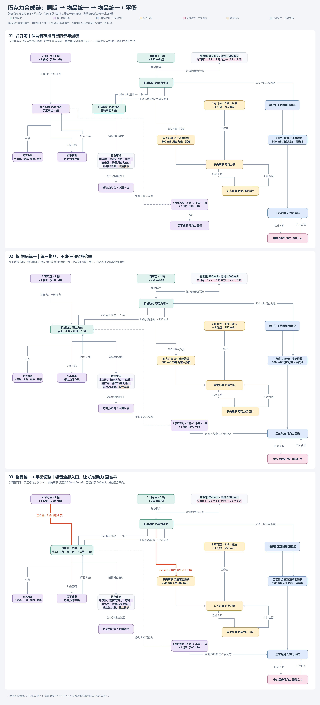

# Chocolate 巧克力链整合计划（2026-10-16）

**2026-10-16 用户已批准并实施 OEI + Balancing；静态检查通过，游戏验证及部署待完成。** 用户目标：尽量统一到 Create 侧；Yuushya 明确是独立配方的装饰摆件，单列保留。

## 最新流程图（2026-10-16 入库）

用户授权将最终图片纳入项目。下图为按模组配色、增加节点净距后的 3800 × 8370 版本，包含原版、仅 OEI、OEI + Balancing 三阶段；历史图片路径与迭代说明保留，下方图片为当前项目内入口。

## 实施记录（2026-10-16，当前有效）

- OEI：[chocolate.json](../../pack/overrides/kubejs/data/oei/replacements/chocolate.json)，仅 `neapolitan:chocolate_bar` → `create:bar_of_chocolate` 与 `neapolitan:chocolate_cake` → `createaddition:chocolate_cake`。
- 倍率：[chocolate_recipe_balance.js](../../pack/overrides/kubejs/server_scripts/chocolate_recipe_balance.js)，`neapolitan:chocolate/chocolate_bar` 的 result.count 从 4 改为 1；`farmersdelight:integration/create/filling/chocolate_pie` 的 forge:chocolate 流体输入从 500 改为 250 mB。
- 保留原 recipe ID、配方类型、原料与容器逻辑、结果 ID、条件和液体标签；没有删除或额外增加配方，没有批量改写输入／输出。固液转换、蛋糕 500 mB、储存块 9↔1、建筑入口 4 条、蛋糕 7 片与派 4 片均保持原样。
- 按当前 KubeJS build.16 的 RecipeJS.merge(JsonObject) 和 JsonObject API 实现；Node 语法检查通过。用原 JAR 导出的 47 条巧克力相关配方执行实际 JS（轻量 Gson／事件适配器，非游戏运行），逐字段对比确认只有上述两个数值变化；两条 OEI 的来源及目标均在注册表清单中。
- 待游戏验证：OEI 物品及普通配方统一、1 条手工产量、250 mB 派灌装、两种蛋糕入口汇入工艺附加、切片／储存闭环与容器返还。没有启动游戏、迁移已放置蛋糕、改实例或部署服务器。
- 两服沿用 shared/kubejs.ablink 的共用源；本地提交不代表远端 master 已包含修改。按用户本轮授权打包并提交，打包结果见文末。

以下方案图迭代与早期删入口建议保留为历史；凡与本节冲突，以本节及“最新方案”为准。

## 最新方案：OEI + Balancing（2026-10-16，取代下文旧 trim 建议）

用户决定保留全部原有合成入口，通过倍率区分手工与 Create 加工：OEI 将 Neapolitan 巧克力条统一为 Create 条，将 Neapolitan 巧克力蛋糕统一为 C&A 蛋糕；Neapolitan 工作台条配方输出从 4 改为 1；FD 巧克力派灌装从 500 mB 改为 250 mB。蛋糕灌装仍为 500 mB，其余数量不变。当前已写入两条 OEI 映射和两处倍率补丁；保留所有原配方入口，未改奶类标签。

用户补充奶瓶具有奶类物品标签，本次图示按 1 份奶类物品 = 250 mB 计算；奶类整合以后单独讨论。修正先前桶奶比较：调整后每条巧克力，手工为 2 可可豆 + 1 糖 + 250 mB 奶，Create 为 1 可可豆 + 1 糖 + 250 mB 奶；优势是省一半可可豆，不是省奶。派的手工原料为 3 可可豆 + 2 糖 + 750 mB 奶 + 派皮，调整后机器路线为 1 可可豆 + 1 糖 + 250 mB 奶 + 派皮。

已生成三阶段图解文档（原版／仅 OEI／OEI + Balancing），长图尺寸 2200 × 5060；橙色标记条产量 4→1，绿色标记派注液 500→250 mB，蓝色标记 OEI 目标。原版只纳入本机已启用的作者联动，不把未启用的中央厨房 Neapolitan 包当作实际规则。三版均独立保留 Yuushya 摆件。

- 图片：`C:\mydata\Agents\Codex-CreateTrainResync\chocolate-audit-20261016\delivery\chocolate-routes-three-stages.png`
- 可复现排版脚本：同级上层 `render_routes.py`（Pillow + Windows 微软雅黑）；已检查整体预览与文字宽度。仅方案制图，无游戏验证。

用户指出上述表格式路线不符合要求，已重做为有分支、汇合与回路的三张真正 flowchart，配短说明合成大图。新版交付为 `C:\mydata\Agents\Codex-CreateTrainResync\chocolate-audit-20261016\delivery\chocolate-flowcharts-three-stages.png`，3000 × 6780；复现脚本为 `render_flowcharts.py`。旧表格图不再作为本次最终交付。

同日按用户要求进一步调整视觉编码：全部方块按来源模组配色（成品按所属模组，原料组合／加工按配方来源，多模组汇总用底部色条）；只在图 3 将两处倍率变化的连线以统一橙红色加粗。最终图片为同目录 `chocolate-flowcharts-mod-colors.png`，3000 × 6900，已检查渲染预览；替代前版图作为最新交付，配方方案未变。

最终排版修订：多模组节点的底部色条改为对应文字的背景高亮；“香草巧克力手指”改为“香草巧克力条”，“Yucca Fudge”改为“丝兰软糖”，模组名称和说明改用中文。底部灰字仅保留方块小镇摆件介绍，删除第二行日期与状态说明；方案仍未实施，状态以本文记录为准。

后续版式修订：顶部图例使用“机械动力：工艺与附加”“那不勒斯风味”全称，图内使用“工艺附加”“那不勒斯”简称。增加节点间距、将派切片向右分流并重新连接回路；设置方块间最小净距 100 px，逐对几何检查三图实际最小值分别为 128、130、130 px。最新版图片沿用 `chocolate-flowcharts-mod-colors.png`，尺寸为 3800 × 8370，已检查整体预览，替代前述旧尺寸；流程及倍率不变。

## 早期建议结论（历史：删入口方案已被上述保留入口方案取代）

第一步以 `create:bar_of_chocolate` 作为唯一基础巧克力条、`create:chocolate` 作为基础巧克力液体；所有模组的巧克力条输入／输出接到这个链路。保留 Neapolitan 的特色甜点、建筑块及 Farmer’s Delight 的巧克力派。不同成品不因为含 chocolate 就变成同一种食物。第二步再单独讨论两种可食巧克力蛋糕，倾向 Create Crafts & Additions 版本，但先明确食物效果／摆放行为取舍。

## 调查范围与证据

- 在先前已提取的 12,946 个物品注册 ID 上，对所有本机启用 JAR 的 `assets/*/lang/en_us.json` 做 ID 或英文显示名含 chocolate（不区分大小写）的筛选。匹配 **31 个物品**：非 Yuushya 29 个，Yuushya 2 个。全部 31 项 ID 本身均命中，英文名未额外增加 ID；不将 tooltip、JEI 提示、未安装模组的可选标签引用当作物品。
- 英文名称按 JAR 默认 en_us 资源记录，不等于运行时资源包最终显示结果。搜查仓库 KJS 未发现巧克力配方或 OEI 专项覆盖；已有 `cake_is_a_lie.js` 仅删除 `minecraft:cake`，不删除这两种巧克力蛋糕。Yuushya 厨师礼包也引用其两种摆件，维持原样。
- 主要版本：Create 0.5.1.j、Create Central Kitchen 1.3.13（for 0.5.1.j）、Neapolitan 5.1.0、Create Crafts & Additions 1.20.1-1.2.5；其余版本见全包清单。此前已核对实例 JAR 与仓库索引一致。
- 依据本地 JAR 配方 JSON、标签、内置数据包和针对性的 javap 检视；没有启动游戏，没有把数据生成器里的配方当作运行时已启用配方。最终配方加载仍须实施后检查。

## 所有匹配物品（逐项）

| 编号 | 物品 ID | JAR 英文名称 | 建议处理 |
| --- | --- | --- | --- |
| 1 | `create:bar_of_chocolate` | Bar of Chocolate | 唯一标准基础巧克力条 |
| 2 | `create:chocolate_bucket` | Chocolate Bucket | 保留；基础液体以 create:chocolate 为准 |
| 3 | `create:chocolate_glazed_berries` | Chocolate Glazed Berries | 特色成品保留；有巧克力条输入时改为 Create 条 |
| 4 | `create_central_kitchen:chocolate_cake_slice` | Slice of Chocolate Cake | 保留 C&A 蛋糕切片及 7 片还原链 |
| 5 | `create_central_kitchen:incomplete_neapolitan_ice_cream_chocolate` | Incomplete Neapolitan Ice Cream | 加工中间物；保留，不当作独立巧克力食材统一 |
| 6 | `create_things_and_misc:spout_gun_chocolate` | Spout Gun | 工具；保留原 1000 mB Create 巧克力灌装 |
| 7 | `createaddition:chocolate_cake` | Chocolate Cake | 已采用 OEI 统一为 C&A 蛋糕，保留两种制作入口；待游戏验证 |
| 8 | `farmersdelight:chocolate_pie` | Chocolate Pie | 派及切片保留；灌装 500→250 mB，手工入口保留 |
| 9 | `farmersdelight:chocolate_pie_slice` | Slice of Chocolate Pie | 派及切片保留；灌装 500→250 mB，手工入口保留 |
| 10 | `infinitybuttons:chiseled_chocolate_brick_secret_button` | Chiseled Chocolate Brick Secret Button | 装饰机关；保留其 Neapolitan 錾制巧克力砖输入 |
| 11 | `neapolitan:chiseled_chocolate_bricks` | Chiseled Chocolate Bricks | 建筑链保留；入口改用 Create 巧克力条，数量不变 |
| 12 | `neapolitan:chocolate_bar` | Chocolate Bar | OEI 统一为 create:bar_of_chocolate；保留手工入口，产量 4→1 |
| 13 | `neapolitan:chocolate_block` | Chocolate Block | 保留为储存块；9 Create 巧克力条 ↔ 1 块 |
| 14 | `neapolitan:chocolate_brick_slab` | Chocolate Brick Slab | 建筑链保留；入口改用 Create 巧克力条，数量不变 |
| 15 | `neapolitan:chocolate_brick_stairs` | Chocolate Brick Stairs | 建筑链保留；入口改用 Create 巧克力条，数量不变 |
| 16 | `neapolitan:chocolate_brick_wall` | Chocolate Brick Wall | 建筑链保留；入口改用 Create 巧克力条，数量不变 |
| 17 | `neapolitan:chocolate_bricks` | Chocolate Bricks | 建筑链保留；入口改用 Create 巧克力条，数量不变 |
| 18 | `neapolitan:chocolate_cake` | Chocolate Cake | 已采用 OEI 统一为 C&A 蛋糕，保留两种制作入口；待游戏验证 |
| 19 | `neapolitan:chocolate_ice_cream` | Chocolate Ice Cream | 特色成品保留；有巧克力条输入时改为 Create 条 |
| 20 | `neapolitan:chocolate_ice_cream_block` | Chocolate Ice Cream Block | 特色成品保留；有巧克力条输入时改为 Create 条 |
| 21 | `neapolitan:chocolate_milkshake` | Chocolate Milkshake | 特色成品保留；有巧克力条输入时改为 Create 条 |
| 22 | `neapolitan:chocolate_spider_eye` | Chocolate Spider Eye | 特色成品保留；有巧克力条输入时改为 Create 条 |
| 23 | `neapolitan:chocolate_strawberries` | Chocolate Strawberries | 特色成品保留；有巧克力条输入时改为 Create 条 |
| 24 | `neapolitan:chocolate_tile_slab` | Chocolate Tile Slab | 建筑链保留；入口改用 Create 巧克力条，数量不变 |
| 25 | `neapolitan:chocolate_tile_stairs` | Chocolate Tile Stairs | 建筑链保留；入口改用 Create 巧克力条，数量不变 |
| 26 | `neapolitan:chocolate_tile_wall` | Chocolate Tile Wall | 建筑链保留；入口改用 Create 巧克力条，数量不变 |
| 27 | `neapolitan:chocolate_tiles` | Chocolate Tiles | 建筑链保留；入口改用 Create 巧克力条，数量不变 |
| 28 | `neapolitan:mint_chocolate` | Mint Chocolate | 特色成品保留；有巧克力条输入时改为 Create 条 |
| 29 | `neapolitan:vanilla_chocolate_fingers` | Vanilla Chocolate Fingers | 特色成品保留；有巧克力条输入时改为 Create 条 |
| 30 | `yuushya:chocolate_cake` | Chocolate Cake | 装饰摆件；独立保留，不参与食物统一 |
| 31 | `yuushya:chocolate_milk` | Chocolate Milk | 装饰摆件；独立保留，不参与食物统一 |

## 现有生产链及差异

| 路线 | 已核对的原始配方 | 含义 |
| --- | --- | --- |
| Create 基础液体 | 1 糖 + 1 可可豆 + 250 mB `forge:milk`，加热搅拌 → 250 mB `create:chocolate` | 保留为基础生产入口 |
| Create 固液转换 | 250 mB 巧克力压块 → 1 `create:bar_of_chocolate`；1 条加热搅拌 → 250 mB | 保持 1 条 = 250 mB |
| Neapolitan 原始巧克力条 | 1 个 `forge:milk` 物品 + 2 可可豆 + 1 糖，工作台 → 4 `neapolitan:chocolate_bar` | 与 Create 数量、机器门槛不同；建议删除这一生产入口，而非单纯改成产出 4 Create 条 |
| Neapolitan 储存块 | 9 条 → 1 `chocolate_block`；拆解 → 9 条 | 双向都改为 Create 条，维持 9:1 |
| Neapolitan 砖 | 4 条 → 1 `chocolate_bricks`；再到砖台阶／楼梯／墙／錾制砖、瓷砖及其变体 | 保留建筑输出，入口改为 Create 条 |
| C&A 巧克力蛋糕 | 1 `createaddition:cake_base_baked` + 500 mB Create 巧克力灌装 → 1 蛋糕 | Create 侧自动化成品；中央厨房 FD 数据包支持 1 蛋糕 ↔ 7 切片 |
| Neapolitan 巧克力蛋糕 | 2 个奶类物品 + 2 糖 + 2 小麦 + 3 巧克力条 + 1 蛋 → 1 蛋糕 | 目前另一个成品与独立成本；不是简单别名 |
| FD 巧克力派 | 原工作台：3 可可豆 + 3 奶类物品 + 2 糖 + 派皮；已有 Create 条件配方：派皮 + 500 mB `forge:chocolate` 灌装 → 派 | 可以直接利用现成 Create 路线；派与蛋糕不合并 |
| 巧克力派切片 | 1 派切成 4 片；4 片拼回 1 派 | 保留 |
| Yuushya 两项 | `yuushya:catering_blueprint` 切石 → 4 个对应摆件 | 没有巧克力条中间产物，完全独立保留 |

## 中央厨房：必须区分资源存在与实际启用

本机 JAR 含 `datapacks/neapolitan/`，其中确实预设了一套**偏向保留 Neapolitan 条**的整合：
- 覆盖 `create:compacting/chocolate`，令 250 mB Create 巧克力产出 `neapolitan:chocolate_bar`。
- 给 Neapolitan 工作台巧克力条配方加 `forge:false` 条件；把许多下游输入改为 `forge:bars/chocolate`。
- 覆盖 Create 熔化配方为 chocolate bar 标签输入，250 mB 输出。

但当前存档的 `DataPacks.Enabled` 只包含中央厨房的 `create_central_kitchen:farmersdelight`，不包含其 Neapolitan／Peculiars 数据包。当前 `BuiltinResource` 枚举也仅列 CREATE_STYLED、FARMERSDELIGHT、MINERS_DELIGHT、OVERWEIGHT_FARMING、CORN_DELIGHT、ENDS_DELIGHT，未注册 Neapolitan 包。故本计划**不把 Neapolitan 内置包当作当前有效覆盖，也不建议直接整体启用它**。否则会反向把 Create 条替换掉，与用户目标相反。

数据生成器 `NeapolitanRecipes` 还保留了搅拌、灌装、蛋糕、冰淇淋液体及回收定义；仅见生成器类不能证明这些配方实际加载。未来若恢复／升级该兼容包，须复查覆盖顺序和数量。

## 早期拟实施方案（历史；删除入口建议未采用）

### 1. 统一基础原料（建议第一批）

1. 新增定向 OEI 规则：`neapolitan:chocolate_bar` → `create:bar_of_chocolate`，仅这一项，由 OEI 承担物品统一及常规配方输入／输出的替换；不把特色巧克力甜点或 Yuushya 摆件加入规则。当前 1.0.5.1 的 ItemStack Mixin 会替换栈内 item/delegate，不只处理旧库存。实施后核验实际配方可用性，不预先叠加 KJS 批量替换。
2. KJS 只处理生产路线取舍：移除 `neapolitan:chocolate/chocolate_bar` 原料直合成配方，避免 OEI 统一后该入口仍直接产出 4 条 Create 巧克力。其余配方不另写全量 replaceInput／replaceOutput；只有实际验证发现 OEI 未覆盖的特定配方时，再定向处理。
3. 验证 `create:compacting/chocolate` 最终产出 Create 条，`create:mixing/chocolate_melting` 仍为 1 条 → 250 mB；正常时不重复定义原配方。
4. 标签统一：确认 `forge:bars/chocolate` 与 `supplementaries:chocolate_bars` 包含 Create 条；不预先清理旧条标签或重复改写直接 ID 引用；若发现特定标签匹配失效，再定向补充。标签内可选、未安装模组的条目不必为本任务清理。
5. 保留 9 条 ↔ 1 Neapolitan 储存块、4 条 → 1 Neapolitan 巧克力砖；保留后续建筑配方、掉落和 Infinity Buttons 机关配方。

### 2. 让下游连接 Create，而非抹掉不同成品

- 冰淇淋、奶昔、薄荷巧克力、香草巧克力条、巧克力蜘蛛眼和草莓：保留成品，只替换基础条输入。Create 巧克力浆果用的是甜浆果，Neapolitan 用草莓，不建议合并。
- 两个名称不含 chocolate 的下游也纳入：`neapolitan:neapolitan_ice_cream`（两个制作配方）及 `peculiars:yucca_fudge`，它们直接消耗旧条；只按物品名过滤会漏掉。
- FD 巧克力派：建议保留已存在的 500 mB 灌装配方，移除 `farmersdelight:chocolate_pie` 的原料工作台入口，保留切片／还原。这是将其原料加工接入 Create 的玩法调整，不是修复损坏配方。
- 不建议为所有甜点另造一套机器配方。当前先用 Create 生产标准原料，现有甜点配方消费它；需要更强自动化时再定向引入并验证联动。
- CCK 热可可液体配方在已启用 FD 包中：125 mB 奶 + 125 mB 巧克力加热搅拌 → 250 mB 热可可。它是饮料，不是基础巧克力液体；保留。

### 3. 巧克力蛋糕（建议第二批单独决定）

倾向最终保留 `createaddition:chocolate_cake` 及中央厨房切片，移除 `neapolitan:chocolate_cake` 的重复整蛋糕生产入口。但在确认进食效果、切片／摆放状态、相关成就或用途之前，不做无条件 OEI 替换。若决定保留 Neapolitan 的特色效果，则保留两种成品而统一巧克力原料即可。

若用户决定合并：应将旧 Neapolitan 蛋糕库存迁移至 C&A 版本、隐藏旧成品，删旧工作台生产链，保留 C&A 蛋糕坯 + 500 mB 巧克力灌装，以及 7 片 ↔ 1 蛋糕闭环。不能让旧工作台原料链仅换产物后继续旁路生产。世界里已摆放蛋糕的迁移不能仅凭物品栈替换保证，须另行处理或明确保留旧放置块。

### 4. 数量与回收检查

| 对象 | 以 1 条 = 250 mB 计算 | 处理建议 |
| --- | ---: | --- |
| 9 条储存块 | 2250 mB | 本轮不额外添加流体回收；若以后加，应按 2250 而非套用统一建筑块标签 |
| 4 条巧克力砖／同等瓷砖 | 1000 mB | 若引入回收可按此数值 |
| 半砖 | 500 mB | 以其所属砖类制作链为基准 |
| 楼梯 | 切石可 1 砖 → 1 楼梯，因此回收最多 1000 mB | 不按工作台 6→4 的较高成本定回收量，否则切石路线可能增殖 |
| 墙／錾制砖 | 常规转换链不超过 1000 mB | 逐项核对后再加；不混入 9 条储存块 |

生成器中的旧 `melt_chocolate_storage_block` 把 `forge:storage_blocks/chocolate` 统一熔为 1000 mB，而该标签混合 9 条储存块与 4 条砖／瓷砖。若将其启用会造成储存块回收亏损；当前不能称已存在可复现漏洞，更不能把整个标签改为 2250 mB（4 条砖将能回收 9 条）。按具体物品拆分或暂不加回收最稳妥。

## 直接引用旧巧克力条的原始配方（实施核对清单）

以下是 JAR 主数据中的直接 ID 引用，按原样列出；内置包可能覆盖的情况已在上节说明。

| 配方 ID | 类型 | 本次计划 |
| --- | --- | --- |
| `neapolitan:chocolate/bricks/chocolate_bricks` | `minecraft:crafting_shaped` | 由 OEI 统一旧条，核验数量不变 |
| `neapolitan:chocolate/chocolate_bar` | `minecraft:crafting_shapeless` | 移除原料直合成入口 |
| `neapolitan:chocolate/chocolate_bar_from_chocolate_block` | `minecraft:crafting_shapeless` | 由 OEI 统一旧条，核验数量不变 |
| `neapolitan:chocolate/chocolate_block` | `minecraft:crafting_shaped` | 由 OEI 统一旧条，核验数量不变 |
| `neapolitan:chocolate/chocolate_cake` | `minecraft:crafting_shaped` | 第一批只改原料；第二批蛋糕取舍后决定是否删除 |
| `neapolitan:chocolate/chocolate_ice_cream` | `minecraft:crafting_shapeless` | 由 OEI 统一旧条，核验数量不变 |
| `neapolitan:chocolate/chocolate_spider_eye` | `minecraft:crafting_shapeless` | 由 OEI 统一旧条，核验数量不变 |
| `neapolitan:mixed/chocolate_strawberries` | `minecraft:crafting_shapeless` | 由 OEI 统一旧条，核验数量不变 |
| `neapolitan:mixed/mint_chocolate` | `minecraft:crafting_shapeless` | 由 OEI 统一旧条，核验数量不变 |
| `neapolitan:mixed/neapolitan_ice_cream` | `minecraft:crafting_shapeless` | 由 OEI 统一旧条，核验数量不变 |
| `neapolitan:mixed/neapolitan_ice_cream_from_vanilla` | `minecraft:crafting_shapeless` | 由 OEI 统一旧条，核验数量不变 |
| `neapolitan:mixed/vanilla_chocolate_fingers` | `minecraft:crafting_shapeless` | 由 OEI 统一旧条，核验数量不变 |
| `peculiars:yucca_fudge` | `minecraft:crafting_shapeless` | 由 OEI 统一旧条，核验数量不变 |

## 早期验收与剩余决定（历史）

实施后检查最终配方注册结果，而不只看文件：Create 压块产物、旧条无新产出、所有下游入口可达、9↔1 储存闭环、4 条砖链无增殖、奶类容器返还、配方查看与自动填充、OEI 旧库存转换；如处理蛋糕，再测 7 片闭环及已放置蛋糕。未安装模组的可选配方不强行加载。

目前建议先批准“基础条统一 + 原料生产走 Create + FD 派采用既有灌装入口”，蛋糕合并留作下一项。此文是讨论计划，不代表已获修改授权。

证据在本机工作目录 `C:\mydata\Agents\Codex-CreateTrainResync\chocolate-audit-20261016`：`scan.py`、`scan.json`、主数据／内置包导出、针对性 javap 文本。关键配方数量、完整 ID、版本和启用边界已写入本页，未来无需依赖本机临时文件才能理解方案。

## 2026-10-16 方案修正：避免与 OEI 重复处理

用户指出 OEI 已负责输入／输出统一。复核本机 1.0.5.1 的 ItemStackMixin 后，撤回预先全量 KJS 替换和重建 Create 固液配方的建议。当前配置的旧 JSON 重写字段与版本不匹配，是既有独立问题；原 JSON 未改写不等于常规配方中的物品栈未统一，不能据此推导必须另写 KJS。专项仍未实施；只保留生产入口删除及针对实际异常的验证。

打包结果（2026-10-16）：已执行仓库 build.bat，7z 输出 Everything is Ok，退出码 0；产物 output/pack.zip 为 130,627,609 字节。按约定未追加 ZIP 完整性／解压比对；未游戏验证、未部署。

## 2026-10-16 游戏配方重载报错修正

用户截图与实例 06:38:00 的 KubeJS server.log 显示 `For input string: "1.0"`，调用链为 RecipeJS.merge → deserialize → ItemStackJS.resultFromRecipeJson → JsonPrimitive.getAsInt → Integer.parseInt。对应巧克力脚本的产量修改；同文件流体量修改也使用相同 addProperty 调用方式。

将 count 和 amount 的写入分别改为 `JsonObject.add(..., JsonParser.parseString('1'/'250'))`，明确生成 JSON 整数原语，避开 JS/Java 重载及包装转换歧义。保持原配方原料、输出 ID、条件和其他数量不变。已同步仓库与 PCL2 实例脚本，SHA-256 均为 `6786052286DC5A022A2D55CF1FE18AB904462E5D5E7E55F5BE2BE246373FBA35`。未更换牛奶 helper。

验证使用已安装 Rhino build.10 与本机 Gson，独立工作区 `milk-audit/GsonRhinoCheck.java` 确认新写法产生数值 1、250 且 getAsInt 通过。注意裸 Rhino 下旧写法产生的是数值 1.0，未独立重现完整 KubeJS 包装链的字符串化；日志已证明游戏实际接收字符串 1.0，但不能把具体归因完全锁定为裸 Rhino 重载选择。此前仅用轻量模拟器检查未覆盖该运行时差异。

旧脚本和报错日志备份在独立工作区 `milk-audit/chocolate-script-error-20261016/`。build.bat 成功，build/pack.zip 已更新（130659161 字节），尚待用户 `/reload` 或退出重进世界确认，不宣称游戏重载已通过；日志中其他已有配方回退警告未在本轮扩大处理。
