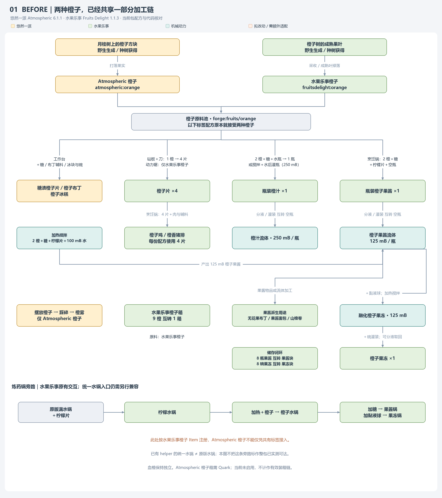
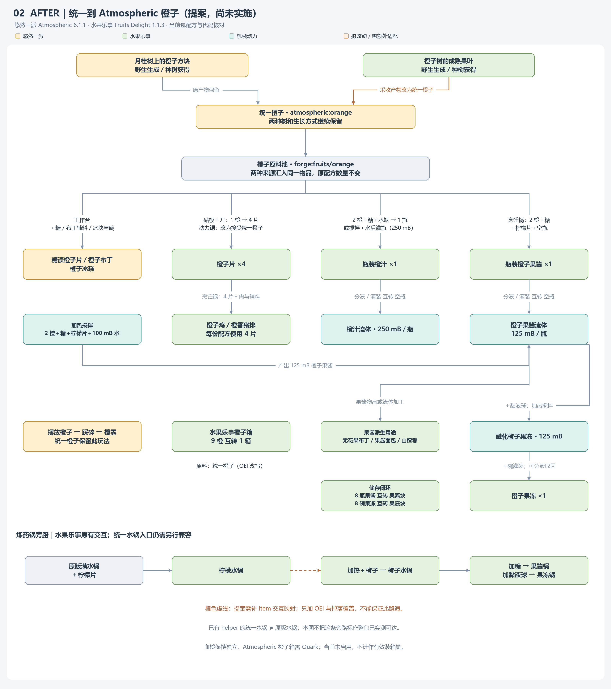

# Orange 橙子整合方案（2026-10-17）

> **待办维护位置更新（2026-10-24）：** 本文的待办／下一步／候选清单保留为历史与技术依据，不再独立维护状态；有效任务统一见[总 todo](../todo-list.md)，炼药锅 mini todo 为例外。功能台账、测试步骤及来源证据仍在本文维护；旧“待实现／待决定”不覆盖总表及mini的最新结论。

**当前仅调查和提案，未修改 OEI、掉落表、配方或 Java 行为，未游戏验证。** 下方 After 是建议目标，不是已实现状态。

## Before / After

## 现有作物统一方式

- `pack/overrides/kubejs/data/oei/replacements/tomato.json`：森罗番茄、种子分别统一到 FD 番茄、种子。
- `rice.json`：FD 稻穗／大米统一到森罗；熟米饭统一到 FD；森罗稻草块统一到 FD 稻米捆。并非一律选同一个模组作为目标。
- `data/farmersdelight/loot_tables/blocks/wild_rice.json`：只改两处非剪刀产物，保留剪刀获得原野生植株的行为。此完整覆盖需随上游升级复核，不能照抄旧版本字段。
- `server_scripts/remove_duplicate_food_recipes.js` 删除已确认重复的加工／种子配方。因此模式是统一可用物品，保留自然来源与必要的植物形态，针对重复或不兼容入口另外处理。

## 核对版本与结论

依据当前索引缓存的 Atmospheric 6.1.1、Fruits Delight 1.1.3、OEI 1.0.5.1 JAR 的资源与字节码，以及当前 KJS；没有联网搜寻其他版本来代替本机证据。

1. 两种橙子都在 `forge:fruits/orange`。多数加工已经可互用，Before 不能画成完全隔离的两条链。
2. Atmospheric 橙子是 `OrangeBlockItem`：可摆放（包含潜行放置逻辑）；`OrangeBlock.fallOn` 可消耗果实并生成橙雾。直接统一到普通水果乐事橙子会失去玩家手持物品的这项能力。
3. 水果乐事橙子有其食用效果体系；统一到 Atmospheric 后，生吃属性以目标为准，OEI 不会自动把两种 Item 的所有功能合并。需要用户认可这项取舍，不能宣称完全等效。
4. 月桂树的橙子方块破坏表为 `atmospheric:blocks/orange`，一处可有 1／2 个橙子；水果乐事成熟果叶表为 `fruitsdelight:blocks/orange_leaves`，保留精准采集／剪刀树叶、成熟状态、时运、树苗和爆炸条件。其右键／自然落果及采收路径调用方块掉落逻辑，不应只关注直接打叶子。
5. OEI 的 `ItemStackMixin.replace` 还会按映射替换栈中的 Item；但这不是修改所有第三方运行时 `Map<Item,...>` 键的证明。
6. 水果乐事 `FDCauldrons.init`、`CauldronRecipe.create` 按 `FruitType.getFruit()` 返回的具体 Item 注册柠檬水锅加入橙子及橙子水锅继续加果实的交互，不能假设共有标签或配方替换自动覆盖。
7. Atmospheric 两条橙子箱装拆配方均要求 Quark，当前包未启用。水果乐事装拆配方无此条件，实际是 9 个水果乐事橙子与 1 箱互转。不要为统一橙子额外启用另一套箱配方。血橙独立保留。

## 建议方案（待用户决定）

| 内容 | 拟处理方式 |
| --- | --- |
| 统一果实 | OEI：`fruitsdelight:orange` → `atmospheric:orange`，优先保留 Atmospheric 的摆放／橙雾玩法。 |
| 野生与种植来源 | 两种树、树苗、树叶、生成和生长机制均保留；将水果乐事 `orange_leaves` 掉落表中果实 entry 的 name 改为目标橙子，其余字段原样保留。按现有做法是同路径 JSON 覆盖；不新增 LootJS。右键、自动落果、破坏三条路径需要验证。 |
| 配方／标签 | 现有共有标签继续使用。OEI 应将写死水果乐事橙子的动力锯、装箱和拆箱 JSON 输入／输出统一；实施时比对实际加载结果，不额外新增一套重复配方。数量保持不变。 |
| 橙子箱 | 保留 `fruitsdelight:orange_crate` 与 9↔1 配方；不新增 Atmospheric 箱入口。 |
| 水果乐事特殊交互 | 为柠檬水锅加橙子、橙子水锅继续加橙子补目标 Item 映射，复用原交互及数量；需另行实现，不能只交付 OEI 后说全部功能保留。 |
| 现有统一水锅 | 水果乐事的柠檬片入口注册在原版水锅交互表；目前 helper 把常用装水入口导向 Amendments 液体锅。本轮发现的是已有入口兼容问题，不是橙子统一造成。是否将该入口也接入统一锅，需单独明确范围；图中未标为当前已实测可达。 |
| 生吃差异 | 采用 Atmospheric 的食用属性，水果乐事生橙的原效果不自动保留；成品菜肴、果酱、果汁等原物品不变。若希望保留两者食用特性，需要另议，不擅自加效果。 |
| 其他 | 不统一血橙，不改倍率，不改生成概率，不移除任何树种，不扩大到其他水果。 |

如果只接受 OEI + 掉落表、完全不补运行时交互，则反向统一到 `fruitsdelight:orange` 改动更少，但会牺牲 Atmospheric 手持橙子的摆放功能。当前推荐方向以保留独特交互为优先；两种方向都有明确取舍，尚未实施。

## 主要配方与数量

图以玩家加工流向为主，辅助材料合并标注。以下是核对过的细节：

| 路线 | 原配方／结果 |
| --- | --- |
| 糖渍橙子片 | 1 橙＋糖 → 1 `atmospheric:candied_orange_slices`。 |
| 橙子布丁 | 1 橙＋甜浆果＋可可豆＋蛋标签＋奶标签 → 1 `atmospheric:orange_pudding`。 |
| 橙子冰糕 | 当前已装 Neapolitan，使用碗＋橙＋`neapolitan:ice_cubes`＋糖；用原版冰的另一个条件配方不启用。 |
| 橙子片 | FD 砧板：橙子标签＋刀 → 4 `fruitsdelight:orange_slice`；Create cutting：当前写死水果乐事橙子，同样输出 4 片。 |
| 橙子鸡 | 烹饪锅：生鸡肉＋4 橙子片＋糖＋碗 → 1 `fruitsdelight:orange_chicken`。 |
| 橙香猪排 | 烹饪锅：生猪肉＋4 橙子片＋卷心菜标签＋碗 → 1 `fruitsdelight:orange_marinated_pork`。 |
| 橙汁 | 工作台：水瓶＋糖＋2 橙 → 1 瓶；Create 搅拌：250 mB 水＋糖＋2 橙 → 250 mB 橙汁流体。空瓶灌装／分液为每瓶 250 mB。 |
| 橙子果酱 | 烹饪锅：2 橙＋糖＋柠檬片＋空瓶 → 1 瓶；Create 加热搅拌：同类原料＋100 mB 水 → 125 mB 果酱。灌装／分液为每瓶 125 mB。 |
| 橙子果冻 | Create 加热搅拌：125 mB 果酱＋黏液球 → 125 mB 融化果冻；加碗灌装为 1 碗，分液返碗。 |
| 果酱派生 | 无花果布丁用瓶装橙子果酱；Create 给面包／山楂片灌装 125 mB 果酱，分别得到带 ORANGE 效果 NBT 的果酱面包／山楂卷。通用果酱配方也保留，不更改其效果体系。 |
| 储存 | 8 瓶果酱或 8 碗果冻合成相应块；拆块配合 8 空瓶／碗返回 8 份。对应流体 1000 mB 可由 Create 压块。 |
| 炼药锅旁路 | 原版满水锅＋柠檬片 → 柠檬水锅；加热加果实 → 橙子水锅；糖 → 果酱锅；黏液球 → 果冻锅。具体状态／消耗由原代码负责，本轮不调整，尚未做整包可达性游戏验证。 |

## 证据、产物与待验证

- 本机提取资源与 javap 输出：`C:/mydata/Agents/Codex-CreateTrainResync/orange-audit/`。包含 `orange-resources.json`、`atmospheric-orange.txt`、`fruit-leaves.txt`、`fruit-cauldron-recipes.txt`、`oei-stack.txt`。大文件留在工作目录，不入库。
- 图为同目录 `orange-before.png`、`orange-after.png`（3200×3600）；生成器 `render_orange_flowcharts.py` 使用 Pillow 与 Windows 微软雅黑，输出到脚本旁 delivery/。已检查预览及原尺寸分区；只保存方案资产，不改游戏配置。
- 后续实施后重点：两种自然来源与时运／剪刀分支；动力锯与砧板各 4 片；箱 9↔1 闭环；水果乐事特殊锅交互及统一水锅入口；原有橙子摆放／橙雾；生吃属性取舍。未把静态检查当作游戏验证。
